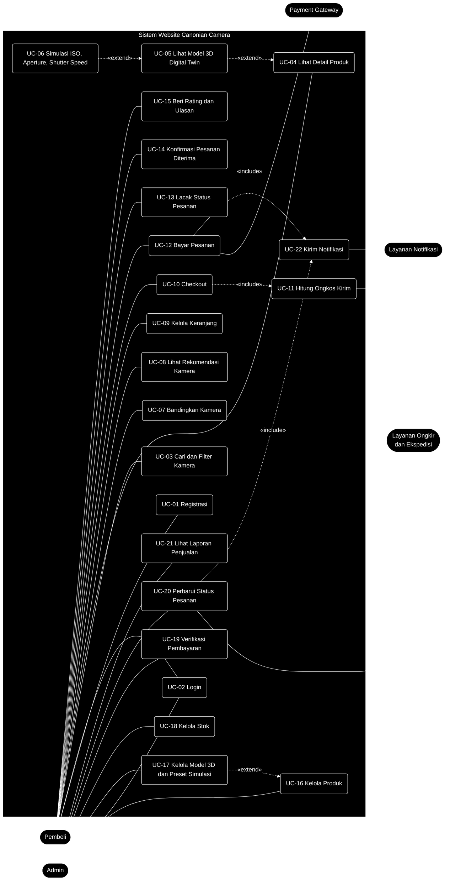
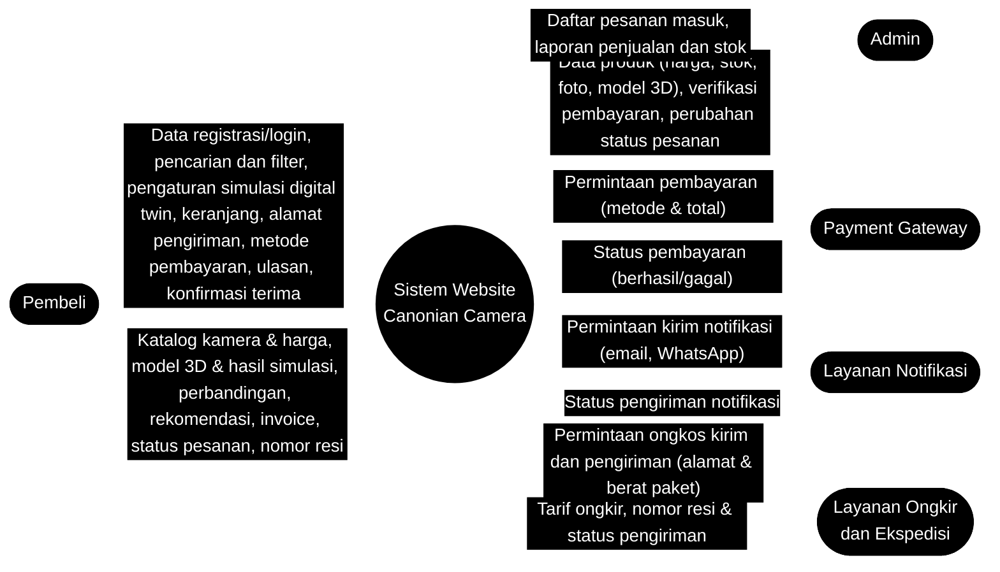
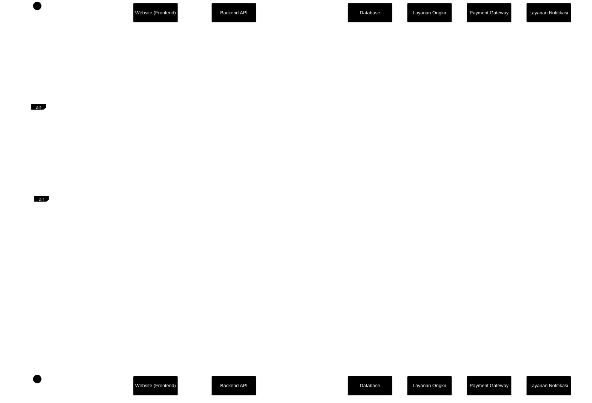
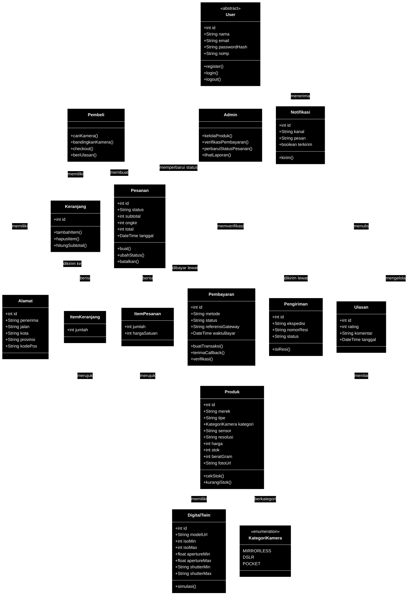

# 📷 Dokumentasi Perancangan Sistem - Canonian Camera

Dokumentasi ini merinci pemodelan sistem fungsional dan struktural dari platform **Canonian Camera**, yaitu web store jual-beli **kamera digital** (Mirrorless, DSLR, dan Pocket/Compact) dengan fitur **digital twin**, yang dibangun berdasarkan pendekatan *Object-Oriented Analysis and Design (OOAD)*.

> 💡 **Catatan:** Diagram di bawah memakai sintaks **Mermaid** (otomatis tampil di GitHub/VS Code). Jika ingin versi gambar draw.io, gambar ulang berdasarkan penjelasan tiap bagian lalu ganti blok Mermaid dengan tag ``.

---

## 0. Konsep Sistem: Barang Fisik dengan Digital Twin

Canonian Camera menjual **barang fisik berspesifikasi teknis**, dan menambahkan **digital twin** agar pembeli dapat mencoba kamera secara virtual sebelum membeli. Dua sifat ini memengaruhi hampir semua diagram di bawah:

| Aspek | Kamera digital (barang fisik) | Dampak pada rancangan sistem |
|---|---|---|
| Stok | Jumlah terbatas dan berkurang setiap ada pembelian | Ada atribut `stok`; stok dicek saat checkout, ditahan saat pesanan dibuat, dan dikembalikan jika pesanan batal |
| Kategori | **Mirrorless**, **DSLR**, dan **Pocket/Compact** | Ada enumerasi `KategoriKamera` agar katalog dapat dikelompokkan dan difilter |
| Spesifikasi teknis | Sensor, resolusi, mount, titik fokus, zoom optik berbeda tiap kamera | Ada atribut `sensor` dan `resolusi`; filter pencarian mencakup resolusi dan jenis sensor |
| Digital twin | Tiap kamera punya model 3D dan rentang ISO, aperture, shutter speed sesuai kamera aslinya | Ada kelas `DigitalTwin`, serta use case lihat model 3D dan simulasi |
| Pengiriman | Barang elektronik harus diantar ke alamat pembeli | Alamat wajib saat checkout; ada aktor **Layanan Ongkir dan Ekspedisi** dan nomor resi |
| Status pesanan | Lebih panjang dari produk digital | menunggu pembayaran → menunggu verifikasi → diproses → dikirim → selesai (atau dibatalkan) |
| Penjualan berulang | Satu model dapat dibeli banyak kali selama stok masih ada | Relasi `Produk` ke `ItemPesanan` bersifat `0..*` |

---

## 1. Use Case Diagram (Interaksi Pengguna dengan Sistem)

---

## 👥 A. Identifikasi Aktor (Actors)

Sistem ini melibatkan lima aktor dengan batas hak akses dan peran yang terdefinisi secara jelas:

*   **Pembeli (*Primary Actor*)**: Pengguna akhir yang menjelajahi katalog, mencoba digital twin, membandingkan kamera, mengelola keranjang, serta melakukan transaksi pembelian.
*   **Admin (*Secondary Actor*)**: Pengelola internal yang memperbarui data produk (harga, stok, foto, model 3D), memverifikasi pembayaran, memperbarui status pesanan, dan memantau laporan penjualan.
*   **Payment Gateway (*External Actor*)**: Sistem pihak ketiga (sandbox pada tahap pengembangan, contoh Midtrans/Xendit) yang memproses dan mengesahkan pembayaran.
*   **Layanan Ongkir dan Ekspedisi (*External Actor*)**: Sistem pihak ketiga (contoh RajaOngkir) yang menghitung tarif, menerima permintaan pengiriman, mengantar paket, dan memberikan nomor resi.
*   **Layanan Notifikasi (*External Actor*)**: Sistem pihak ketiga yang mengirim notifikasi status pembayaran dan pesanan lewat email atau WhatsApp.

---

## ⚙️ B. Pembongkaran Fungsionalitas (Use Cases)

### a. Fitur Spesifik Pembeli
*   **Registrasi (UC-01):** Pendaftaran pengguna baru agar data kredensial tersimpan dalam basis data.
*   **Login (UC-02):** Otentikasi pengguna terdaftar untuk mengakses hak istimewa transaksi.
*   **Cari dan Filter Kamera (UC-03):** Mempersempit katalog berdasarkan kata kunci, kategori, merek, rentang harga, resolusi, dan jenis sensor.
*   **Lihat Detail Produk (UC-04):** Menampilkan galeri foto, spesifikasi lengkap, harga, stok, dan ulasan.
*   **Lihat Model 3D Digital Twin (UC-05):** Memutar model 3D kamera 360° dan memperbesar tampilan.
*   **Simulasi ISO, Aperture, Shutter Speed (UC-06):** Mengubah pengaturan kamera virtual dan melihat perkiraan hasil foto.
*   **Bandingkan Kamera (UC-07):** Menampilkan 2–3 kamera berdampingan.
*   **Lihat Rekomendasi Kamera (UC-08):** Menyarankan kamera berdasarkan kebutuhan (pemula, vlog, fotografi) dan anggaran.
*   **Kelola Keranjang (UC-09):** Penampung pesanan sementara untuk menambah, mengubah jumlah, atau menghapus item sebelum dibayar.
*   **Checkout (UC-10):** Mengubah isi keranjang menjadi pesanan, termasuk memilih alamat pengiriman dan metode pembayaran.
*   **Bayar Pesanan (UC-12):** Menyelesaikan pembayaran lewat payment gateway.
*   **Lacak Status Pesanan (UC-13):** Memantau status dan histori transaksi, termasuk nomor resi.
*   **Konfirmasi Pesanan Diterima (UC-14):** Menandai paket sudah diterima sehingga pesanan selesai.
*   **Beri Rating dan Ulasan (UC-15):** Menilai kamera yang sudah dibeli.

### b. Fitur Spesifik Admin
*   **Kelola Produk (UC-16):** Operasi tambah, ubah, hapus (*CRUD*) data produk, termasuk harga, kategori, spesifikasi, dan foto.
*   **Kelola Model 3D dan Preset Simulasi (UC-17):** Mengunggah model GLB dan mengatur rentang ISO, aperture, shutter speed sesuai kamera aslinya.
*   **Kelola Stok (UC-18):** Memperbarui jumlah stok produk.
*   **Verifikasi Pembayaran (UC-19):** Memeriksa dan mengonfirmasi pembayaran yang masuk.
*   **Perbarui Status Pesanan (UC-20):** Memperbarui tahapan pesanan (diproses → dikirim) dan mengisi nomor resi.
*   **Lihat Laporan Penjualan (UC-21):** Memantau penjualan dan stok.

### c. Fungsi Sistem
*   **Hitung Ongkos Kirim (UC-11):** Meminta tarif ke layanan ongkir berdasarkan alamat tujuan dan berat paket.
*   **Kirim Notifikasi (UC-22):** Mengirim pemberitahuan otomatis status pembayaran dan pesanan.

---

## 🔗 C. Analisis Logika Relasi Pembatas (`<<include>>` dan `<<extend>>`)

a.  **Checkout `<<include>>` Hitung Ongkos Kirim**
    *   *Analisis:* Karena kamera adalah barang fisik, setiap checkout wajib memuat ongkos kirim. Tanpa tarif, total pesanan tidak dapat dihitung.
b.  **Bayar Pesanan `<<include>>` Kirim Notifikasi**
    *   *Analisis:* Setiap hasil pembayaran (berhasil atau gagal) selalu diikuti notifikasi ke pembeli, sehingga fungsi ini bukan pilihan.
c.  **Perbarui Status Pesanan `<<include>>` Kirim Notifikasi**
    *   *Analisis:* Setiap perubahan status (diproses, dikirim) memicu notifikasi otomatis.
d.  **Lihat Model 3D Digital Twin `<<extend>>` Lihat Detail Produk**
    *   *Analisis:* Viewer 3D bersifat opsional. Pembeli dapat melihat detail produk tanpa membukanya, dan fitur ini hanya berjalan **jika** pembeli ingin melihat kamera dari berbagai sisi.
e.  **Simulasi ISO, Aperture, Shutter Speed `<<extend>>` Lihat Model 3D Digital Twin**
    *   *Analisis:* Simulasi hanya berjalan **jika** pembeli membuka viewer 3D lalu memilih mengubah pengaturan.
f.  **Kelola Model 3D dan Preset Simulasi `<<extend>>` Kelola Produk**
    *   *Analisis:* Model 3D diunggah **jika** admin ingin melengkapi produk dengan digital twin. Produk tetap dapat dijual tanpa model 3D.

> 🔒 **Hak akses:** UC-03 sampai UC-08 dapat diakses tanpa login. UC-09 sampai UC-15 mewajibkan login sebagai pembeli. UC-16 sampai UC-21 mewajibkan login sebagai admin.

---

## 🔄 D. Penjelasan Runutan Logika Bisnis (Business Logic Flow)

*   **Fase Penjelajahan:** Pembeli melihat katalog, memakai pencarian dan filter, membuka detail produk, mencoba digital twin, dan membandingkan kamera.
*   **Fase Akumulasi:** Kamera pilihan dimasukkan ke keranjang dan jumlahnya dapat diubah.
*   **Fase Validasi Transaksi:** Saat checkout, sistem memeriksa login dan stok, lalu pembeli memilih alamat, melihat ongkos kirim, dan memilih metode pembayaran.
*   **Fase Pembayaran:** *Payment Gateway* mengesahkan pembayaran, lalu pembeli menerima notifikasi.
*   **Fase Pemenuhan Pesanan:**
    *   Setelah pembayaran masuk, admin memverifikasi dan status pesanan menjadi *diproses*.
    *   Admin mengemas pesanan, mengisi nomor resi, dan status menjadi *dikirim*. Sistem meneruskan permintaan ke *Layanan Ekspedisi*.
    *   Pembeli memantau resi di halaman pesanan, lalu mengonfirmasi penerimaan sehingga status menjadi *selesai*. Pembeli kemudian dapat memberi rating dan ulasan.

---

## 2. Context Diagram (Batasan & Aliran Data Sistem)

Diagram konteks memandang seluruh sistem sebagai satu proses tunggal dan memetakan aliran data masuk dan keluar dari entitas luar (*terminator*).

---

## 👥 A. Entitas Luar (External Entities)

*   **Pembeli**: Memberikan data masukan pesanan dan pengaturan simulasi, serta menerima informasi timbal balik.
*   **Admin**: Menyuplai data katalog dan stok, memverifikasi pembayaran, serta memperbarui progres pesanan.
*   **Payment Gateway**: Memproses validasi transaksi keuangan secara otomatis.
*   **Layanan Notifikasi**: Menyampaikan pemberitahuan status pembayaran dan pesanan ke pembeli.
*   **Layanan Ongkir dan Ekspedisi**: Memberi tarif ongkos kirim, menerima permintaan pengiriman, dan mengantar paket ke alamat pembeli.

---

## 🔁 B. Aliran Data Masuk ke Sistem (Input Data Flows)

### a. Dari Pembeli ke Sistem
*   **Data registrasi / login:** Kredensial akun pengguna untuk otentikasi.
*   **Pencarian dan filter:** Kata kunci, kategori, merek, harga, resolusi, dan jenis sensor.
*   **Pengaturan simulasi digital twin:** Nilai ISO, aperture, dan shutter speed yang dipilih.
*   **Keranjang:** Item dan jumlah yang akan dibeli.
*   **Alamat pengiriman dan metode pembayaran:** Tujuan paket dan jalur transaksi keuangan.
*   **Ulasan dan konfirmasi terima:** Rating, komentar, dan penegasan paket sudah diterima.

### b. Dari Admin ke Sistem
*   **Data produk (tambah/ubah/hapus):** Merek, tipe, kategori, sensor, resolusi, harga, stok, foto, dan model 3D beserta preset simulasi.
*   **Verifikasi pembayaran:** Keputusan menerima atau menolak pembayaran.
*   **Perubahan status pesanan:** Update tahapan pesanan dan nomor resi.

### c. Dari Payment Gateway ke Sistem
*   **Status pembayaran (berhasil / gagal):** Respon sah atau tidaknya transaksi.

### d. Dari Layanan Notifikasi ke Sistem
*   **Status pengiriman notifikasi:** Laporan notifikasi terkirim atau gagal.

### e. Dari Layanan Ongkir dan Ekspedisi ke Sistem
*   **Tarif ongkir, nomor resi, dan status pengiriman:** Biaya kirim, nomor pelacakan, dan perkembangan pengantaran.

---

## ↩️ C. Aliran Data Keluar dari Sistem (Output Data Flows)

### a. Dari Sistem ke Pembeli
*   **Katalog kamera & harga:** Daftar produk beserta spesifikasinya.
*   **Model 3D & hasil simulasi:** Viewer digital twin dan pratinjau hasil foto.
*   **Perbandingan dan rekomendasi:** Tampilan berdampingan dan saran kamera sesuai kebutuhan.
*   **Invoice dan status pesanan:** Bukti rincian pembelian dan progres pesanan.
*   **Nomor resi:** Informasi pelacakan paket (setelah pesanan dikirim).

### b. Dari Sistem ke Admin
*   **Daftar pesanan masuk:** Rincian pesanan baru yang harus diverifikasi dan diproses.
*   **Laporan penjualan dan stok:** Ringkasan penjualan dan ketersediaan produk.

### c. Dari Sistem ke Payment Gateway
*   **Permintaan pembayaran (metode & total):** Nominal tagihan dan metode pilihan pembeli.

### d. Dari Sistem ke Layanan Notifikasi
*   **Permintaan kirim notifikasi:** Isi dan tujuan pesan status pembayaran atau pesanan.

### e. Dari Sistem ke Layanan Ongkir dan Ekspedisi
*   **Permintaan ongkos kirim dan pengiriman (alamat & berat paket):** Data untuk menghitung tarif dan instruksi pengiriman setelah pesanan dikemas.

---

## 📌 D. Kesimpulan Batasan Sistem (System Boundary)

**Sistem Website Canonian Camera** bertindak sebagai **jembatan informasi otomatis**. Sistem tidak memproses uang secara mandiri (dialihkan ke *Payment Gateway*), tidak mengantar paket secara langsung (diteruskan ke *Layanan Ekspedisi*), dan tidak mengirim email atau WhatsApp sendiri (diteruskan ke *Layanan Notifikasi*). Sistem mengelola katalog, digital twin, stok, pesanan, dan alur datanya.

---

## 3. Sequence Diagram (Alur Proses Checkout & Pembayaran)

Sequence diagram menggambarkan urutan kronologis pesan pada proses checkout hingga pembayaran selesai. Tahap verifikasi admin, pengiriman, dan konfirmasi diterima berada di luar diagram ini (lihat `03-sequence.md`).

---

## 🏗️ A. Komponen & Objek Sistem (Lifelines)

1.  **Pembeli**: Aktor yang menginisiasi tindakan dan menerima respon visual.
2.  **Website (Frontend)**: Antarmuka tempat pengguna berinteraksi.
3.  **Backend API**: Logika bisnis (Flask) yang memproses permintaan frontend dan menjembatani data.
4.  **Database**: Penyimpanan terpusat data pesanan, produk dan stok, serta pembayaran (SQLite).
5.  **Layanan Ongkir**: Pihak ketiga yang menghitung tarif pengiriman.
6.  **Payment Gateway**: Pihak ketiga yang memvalidasi transaksi keuangan.
7.  **Layanan Notifikasi**: Pihak ketiga yang mengirim pemberitahuan ke pembeli.

---

## 🔄 B. Kronologi Urutan Alur Utama (Sequential Messages)

a.  **Klik Checkout**: `Pembeli` menekan tombol checkout.
b.  **Tampilkan form alamat, kurir, dan metode bayar**: `Frontend` menampilkan isian alamat dan pilihan pembayaran.
c.  **Pilih alamat, kurir, metode, klik Bayar**: `Pembeli` melengkapi data lalu menekan Bayar.
d.  **POST /api/pesanan**: `Frontend` mengirim data transaksi ke `Backend API`.
e.  **Cek stok kamera**: `Backend API` memeriksa ke `Database` apakah stok setiap item masih cukup.
f.  **Return stok**: `Database` mengembalikan data stok terkini.

---

## 🔀 C. Analisis Percabangan Kondisi (Fragment Alt)

### Kondisi A: [stok tersedia]
*   **7-8. Minta tarif ongkir dan Tarif ongkir**: `Backend API` menghitung ongkos kirim lewat `Layanan Ongkir` berdasarkan alamat dan berat paket.
*   **9-10. INSERT pesanan dan Return id pesanan**: `Backend API` menyimpan pesanan berstatus *menunggu pembayaran*, menahan stok, dan menerima ID unik pesanan.
*   **11-12. Minta pembayaran dan Status pembayaran**: `Backend API` meminta otorisasi ke `Payment Gateway` dan menerima hasilnya.
*   **Cabang bersarang (alt):**
    *   *[pembayaran berhasil] (13-16)*: status pesanan menjadi *menunggu verifikasi*, pembeli diberi notifikasi, lalu menerima nomor pesanan dan konfirmasi.
    *   *[pembayaran gagal] (17-20)*: pesanan dibatalkan dan stok dikembalikan, lalu pembeli diberi notifikasi agar dapat mencoba kembali.

### Kondisi B: [stok tidak cukup]
*   **21-22. Respon stok tidak cukup dan Tampilkan pesan stok habis**: pesanan tidak dibuat dan pembeli diminta menyesuaikan jumlah atau memilih kamera lain.

---

## 4. Class Diagram (Struktur Objek & Basis Data)

---

## 🏛️ A. Struktur Kelas Utama dan Atribut (Classes & Attributes)

Sistem didukung oleh 15 kelas (termasuk satu enumerasi) yang saling terhubung:

*   **User**: Super-class abstrak. *Atribut:* `id`, `nama`, `email`, `passwordHash`, `noHp`. *Metode:* `register()`, `login()`, `logout()`.
*   **Pembeli**: Turunan User (konsumen). *Metode:* `cariKamera()`, `bandingkanKamera()`, `checkout()`, `beriUlasan()`.
*   **Admin**: Turunan User (pengelola). *Metode:* `kelolaProduk()`, `verifikasiPembayaran()`, `perbaruiStatusPesanan()`, `lihatLaporan()`.
*   **Alamat**: Alamat pengiriman milik pembeli. *Atribut:* `id`, `penerima`, `jalan`, `kota`, `provinsi`, `kodePos`.
*   **KategoriKamera**: Enumerasi pengelompokan produk. *Nilai:* `MIRRORLESS`, `DSLR`, `POCKET`.
*   **Produk**: Kamera digital yang dijual. *Atribut:* `id`, `merek`, `tipe`, `kategori`, `sensor`, `resolusi`, `harga`, `stok`, `beratGram`, `fotoUrl`. *Metode:* `cekStok()`, `kurangiStok()`.
*   **DigitalTwin**: Model 3D dan preset simulasi tiap kamera. *Atribut:* `id`, `modelUrl` (GLB), `isoMin`, `isoMax`, `apertureMin`, `apertureMax`, `shutterMin`, `shutterMax`. *Metode:* `simulasi()`.
*   **Keranjang**: Wadah item sementara. *Atribut:* `id`. *Metode:* `tambahItem()`, `hapusItem()`, `hitungSubtotal()`.
*   **ItemKeranjang**: Kelas perantara isi keranjang. *Atribut:* `jumlah`.
*   **Pesanan**: Rekaman transaksi pembelian. *Atribut:* `id`, `status`, `subtotal`, `ongkir`, `total`, `tanggal`. *Metode:* `buat()`, `ubahStatus()`, `batalkan()`.
*   **ItemPesanan**: Kelas perantara rincian item. *Atribut:* `jumlah`, `hargaSatuan` (disimpan agar riwayat tidak berubah saat harga produk diubah).
*   **Pembayaran**: Rekaman validasi keuangan. *Atribut:* `id`, `metode`, `status`, `referensiGateway`, `waktuBayar`. *Metode:* `buatTransaksi()`, `terimaCallback()`, `verifikasi()`.
*   **Pengiriman**: Rekaman pengiriman paket. *Atribut:* `id`, `ekspedisi`, `nomorResi`, `status`. *Metode:* `isiResi()`.
*   **Ulasan**: Rating dan komentar pembeli. *Atribut:* `id`, `rating`, `komentar`, `tanggal`.
*   **Notifikasi**: Pesan otomatis ke pengguna. *Atribut:* `id`, `kanal` (in-app/email/WhatsApp), `pesan`, `terkirim`. *Metode:* `kirim()`.

---

## 🔗 B. Analisis Hubungan Pewarisan (Generalization / Inheritance)

*   **User** adalah *Parent Class*.
*   **Pembeli** dan **Admin** adalah *Child Class* yang mewarisi atribut (`id`, `nama`, `email`, `passwordHash`, `noHp`) dan fungsi (`login()`, `logout()`) dari User.

---

## 🔀 C. Hubungan Antar-Kelas dan Multiplisitas (Associations & Multiplicity)

*   **Pembeli - Alamat (`memiliki`)**: `1` ke `0..*`. Satu pembeli dapat menyimpan banyak alamat.
*   **Pembeli - Keranjang (`memiliki`)**: `1` ke `1`. Satu pembeli hanya punya satu keranjang aktif.
*   **Keranjang - ItemKeranjang (`berisi`)**: `1` ke `0..*` (komposisi). Item keranjang tidak berdiri sendiri tanpa keranjangnya.
*   **ItemKeranjang - Produk (`merujuk`)**: `0..*` ke `1`. Tiap item menunjuk tepat satu kamera.
*   **Pembeli - Pesanan (`membuat`)**: `1` ke `0..*`. Satu pembeli dapat membuat banyak pesanan (atau belum ada).
*   **Pesanan - ItemPesanan (`berisi`)**: `1` ke `1..*` (komposisi). Satu pesanan wajib punya minimal satu rincian.
*   **ItemPesanan - Produk (`merujuk`)**: `0..*` ke `1`. Satu model kamera dapat tercatat pada banyak rincian pesanan selama stok masih ada.
*   **Pesanan - Alamat (`dikirim ke`)**: `0..*` ke `1`. Tiap pesanan memiliki satu alamat tujuan.
*   **Pesanan - Pembayaran (`dibayar lewat`)**: `1` ke `1`. Satu pesanan dipasangkan dengan satu catatan pembayaran.
*   **Pesanan - Pengiriman (`dikirim lewat`)**: `1` ke `0..1`. Pengiriman baru tercatat setelah pesanan diproses dan diserahkan ke ekspedisi.
*   **Produk - DigitalTwin (`memiliki`)**: `1` ke `1`. Tiap kamera punya satu paket model 3D dan preset simulasi.
*   **Pembeli - Ulasan (`menulis`)** dan **Ulasan - Produk (`menilai`)**: satu pembeli dapat menulis banyak ulasan, dan satu produk dapat dinilai banyak kali.
*   **User - Notifikasi (`menerima`)**: `1` ke `0..*`. Satu pengguna dapat menerima banyak notifikasi.
*   **Admin - Produk / Pembayaran / Pesanan**: hubungan dependensi, karena admin mengelola produk, memverifikasi pembayaran, dan memperbarui status pesanan.

> 🔎 **Poin pembeda penting:** `Produk` memiliki satu `DigitalTwin` yang menyimpan rentang ISO, aperture, dan shutter speed sesuai kamera aslinya, sehingga simulasi di website tidak menawarkan pengaturan yang mustahil dilakukan kamera tersebut. Selain itu, relasi `Produk` ke `ItemPesanan` bersifat `0..*` karena kamera adalah barang berstok yang bisa dibeli berulang kali, dibatasi atribut `stok`.

> ℹ️ Siklus hidup status Pesanan, Pembayaran, dan Produk (stok) dijelaskan terpisah di `05-state.md`.

---

> ⚠️ Proyek ini adalah tugas perkuliahan. Nama "Canonian" tidak berafiliasi dengan Canon, dan proyek tidak memakai logo, nama model, atau aset resmi Canon.

*Developed with 📷 by Tim Canonian Camera - Rekayasa Perangkat Lunak*
